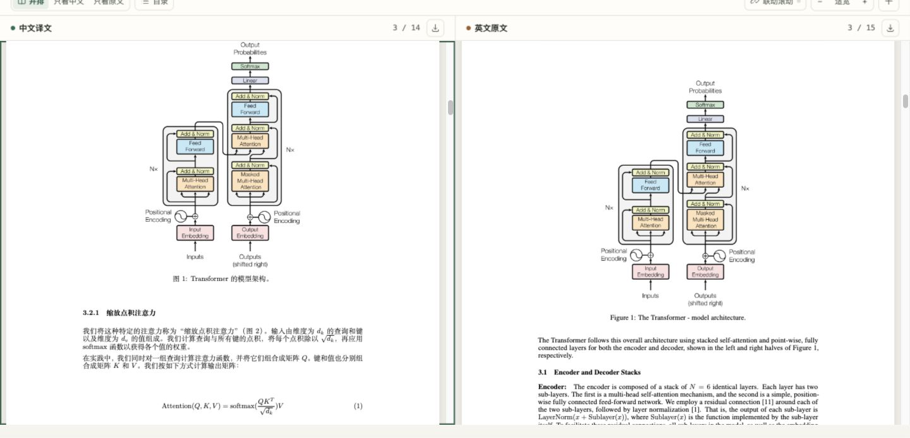

# ＋云翻译 · 幻觉翻译的 Codex 版

**[下载 Skill ZIP](https://github.com/xiaoxiaotibaiwan/arxiv-zh-pdf/raw/refs/heads/main/arxiv-zh-pdf-skill.zip)**

给 Codex 一个 arXiv 链接，翻译论文全文，用原 LaTeX 模板生成中文 PDF，保留公式、图表和参考文献。默认只交付中文 PDF；也可以在本地网页并排阅读中英文，联动滚动。受[幻觉翻译](https://hjfy.top/)启发，独立实现，非官方版本。



截图来源：Vaswani 等，[Attention Is All You Need](https://arxiv.org/abs/1706.03762v7)，NeurIPS 2017，图 1。公开仓库不附论文或译文 PDF。

## 安装与调用

1. 下载并解压 ZIP，把整个 `arxiv-zh-pdf/` 目录复制到 `~/.agents/skills/`，确保 `SKILL.md` 在 `~/.agents/skills/arxiv-zh-pdf/` 下。没显示时重启 Codex。
2. 在本机 Codex 对话里输入：

   ```text
   $arxiv-zh-pdf https://arxiv.org/abs/1706.03762v7
   ```

支持提供 LaTeX 源码的 arXiv 论文。需要已登录的 Codex CLI、Python 3.10+、TeX Live / MacTeX（含 XeLaTeX、xeCJK 和 Fandol 字体）及 Poppler（`pdfinfo`、`pdftotext`）。依赖和网页配置详见 ZIP 内的 `INSTALL.md`。

要用网页阅读器，在论文工作区运行以下命令，再打开终端显示的本地地址：

```bash
python3 "$HOME/.agents/skills/arxiv-zh-pdf/scripts/reader.py" --enable-codex
```
